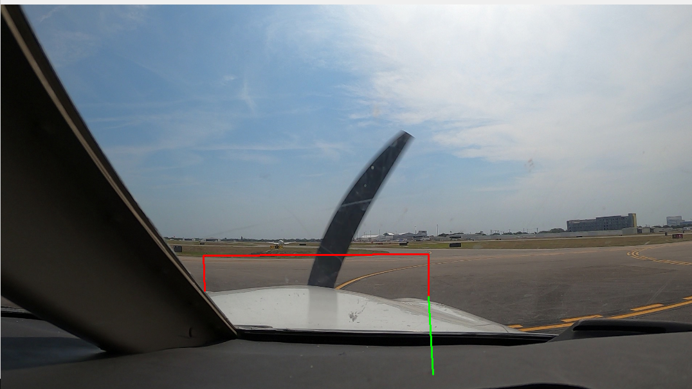
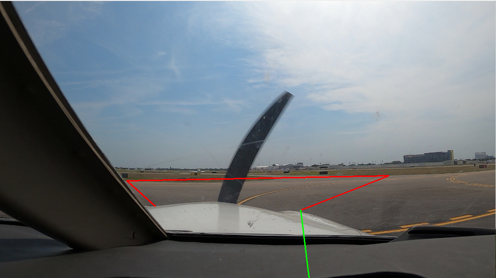
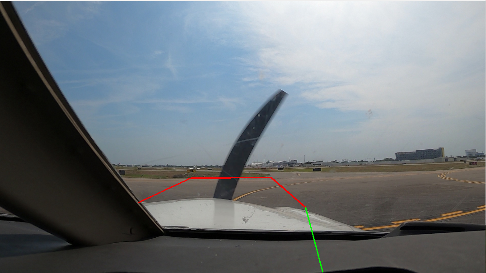
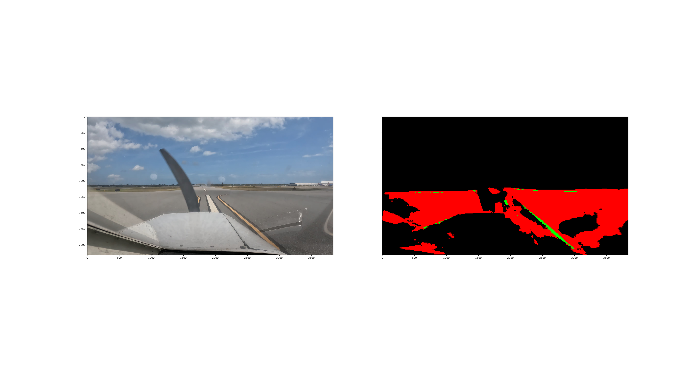
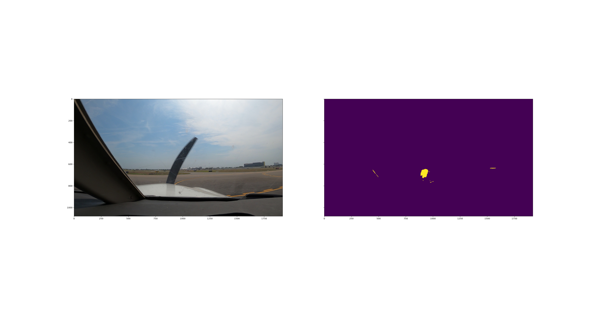
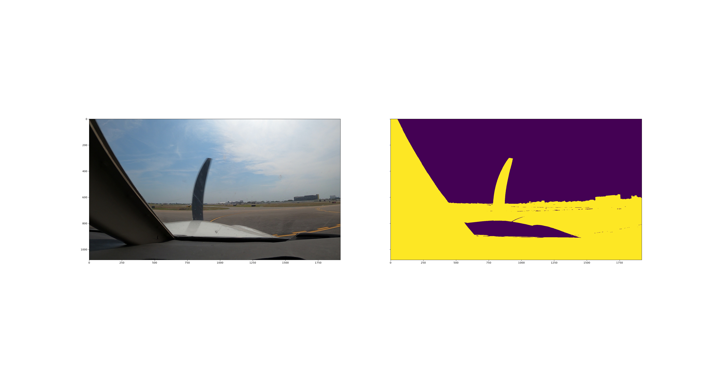
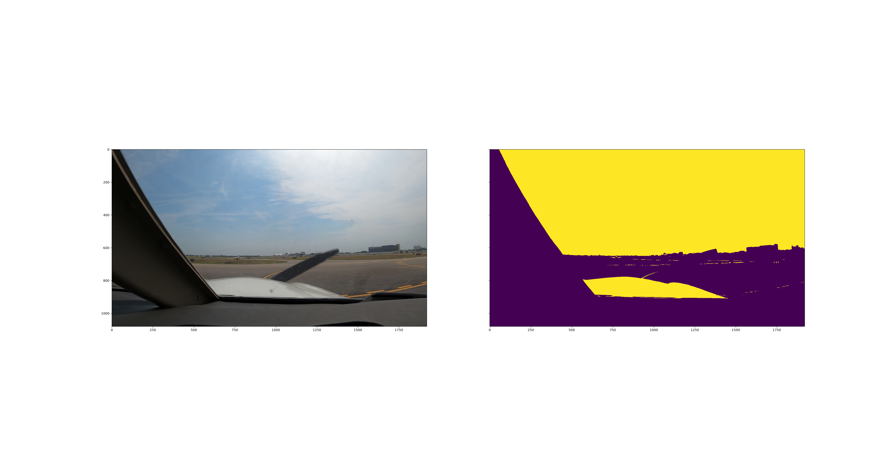
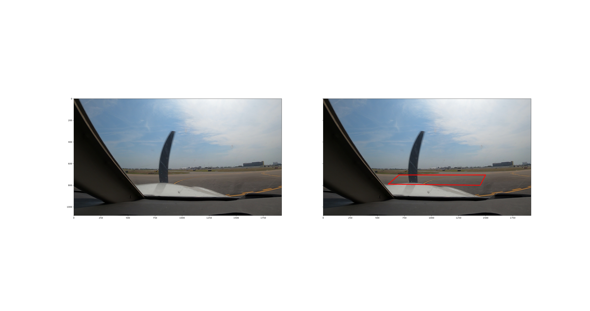

# Assignment 5 -- Connor Westcott

This readme is stuctured as following
- First part is the contents found in EXPERIMENTS.md which is a report on how to run the code experiments and the results and discussions as requested in the homework assignment 5. 
- second part is the assignemnt 4 EXPERIMENTS.md which is left unchanged from that assignment and is there for continiutiy. 
- third part is the original readme of the forked github
  


# Assignment 4 -- Connor Westcott

# Running experiments

All code required is within the `assignment4` folder. The only command to run the pipeline needed is the following:
```python a4.py```

However, to conduct various experiments the bottom of the code configuration will need to be updated by the user. This could have been command line arguments, but for rapid prototyping on the assignmnet timeline it is manual configurations. 

```    args = {
        "input_dir": "./../data/Raw_Data/vidd_3",
        "output_images_dir": "./../outputs/tmp/annotated",
        "output_coords_dir": "./../outputs/tmp/coords", 
        "log_file": "./../outputs/tmp/timing.log",
        "peak_threshold": 5,
        "min_white_pixels": 20,
        "circular_threshold": 15,
        "yellow_lower": [0, 70, 170], # HSV
        "yellow_upper": [255, 255, 255], # HSV
        "mask_ignore_left_columns": 300,
        "custom_roi": None # unet, segnet, segformer, kmeans, claude (None, if manual ALINA pipeline)
    }
```

The arg dictionary is a placeholder for the lack of commandline interfacing for this assignmnet. End users will need to change the "custom_roi" key to the ones commented there: unet, segnet, segformer, kmeans, claude for each of the methods. If the None object is passed in then the system defaults to manual ROI detection. 

# ALINA Manual ROI


Command to run the manual ROI Alinia program

```
alina label   --input-dir data/Raw_Data/vidd_3 \
--output-images-dir outputs/tmp/annotated   \
--output-coords-dir outputs/tmp/coords  \
--log-file outputs/tmp/timing.log
```


Experiments conducted with each video set:
- Large ROI (From Plane nose to Horizon and edge to edge of the frame)
- Small ROI (From Plane nose to Horison as wide as the plane is)
- Trapezoid (small side of traepzoid as wide as plane nose to as wide as the taxiway on horizon)
- Trapezoid (large size of trapeizode wider than plane nose to smaller than horizon size of taxiway)

| Experiement | Avg Recall (%) | Avg Precision (%) | Avg F1 (%) |
| :--- | :---: | :---: | ---: |
| Large ROI | 45.43 | 39.02 | 41.97 |
| Small ROI | 57.14 | 53.12 | 55.08 |
| Trapezoid (Away from plane) | 0.00 | 0.00 | 0.00 |
| Trapezoid (Near plane) | 0.00 | 0.00 | 0.00 | 0.00 |

Table 1: Results of the experiements of manual ROI.






Figure 1: Manual ROI selection of the first image in video set 3. The Large ROI (top), Small ROI (second from top), Trapezoid Small (second from bottom), and the trapezoid large (bottom) are shown. Note, the green line is just an artefact of how the manual ROI selection works and the need to take a screenshot to demonstrate the ROI.


The results of the manual ROI experiements show that with all the default settings, the best ROI is when it is very small and focus on what is directly infront of the plane. A side note is that the frames where the line curves to one side aggressively (see Figure 1) the small ROI struggles while the larger ROI captures the wider taxiway. 


This leads to the conclusion that the ROI needs to have full coverage of the taxiway at any given time. This mean *only* the paved taxiway should be boxed in for consideration. 

Another note: The default line coloring threshold does cause a lot of issues as the reflection in the windscreen is often time found as the "valid" solution when it is indeed, not the valid solution. 


# ROI Experimenation

Before the disscussion on the ML concept, its application, and experimentations. There is a brief need to mention that models were selected due to various constraints that lead to not realistic or to results that would withstand serious review. 

**First constraint**: time, the timeline for the assignment limits the breadth of models that can be trained as having more data points to compare to increases understanding of how and why the data is interacting through the pipeline. However, there is not enough time to fully test heavy state of the art models. 

**Second constrain**: resources, a lot of state of the art VLMs, ViTs, LLMs, etc are dense that requires significant computational resources to store, load, and predict. Additionally there are not many models with out of the box performance that aligns with the identified problem that will be discussed below. This leads into the third constraint. 

**Third constraint**: Data. The data included within the repositorty is a very small sub-set of the entire AssitTaxi dataset. While that dataset could be downloaded there is significant disk storage space constarains that prevent a dataset of that size from being downloaded two of them being time: downloading takes time; resources: need to store and train a model on the data. 

With these three main constrains and their intertwined connections in mind, the goal was to proritze the balance between what the actual problem demands with as state-of-the-art as system requiremetns allow. 

## ROI ML Concept
Based on the results of the manual ROI, the problem is currently defined simply as:
```given an image identify any pixel that belongs to the taxiway```

With this in mind the probelm now falls into the category of "image segmentation". Therefore, the basis of the ML system will leverage a image segemenation model to initally classify which pixels belong to the taxiway or not. 

### ROI Methodology 1


To do this we leverage a pre-trained model for road segementation (for cars). [GITHUB REPO USED](https://github.com/yaraeslamm/lane-detection)
While the model linked here is designed for lane detection systems, it offers three classifications:
- Background
- Road
- Lane Marker

Four our purposes only the classification of `Road` is what we want. The justification for this is that the lane markers are different in numerous ways between taxiways and highways. Mainly size and color, but also their meaning. However, the "concept" of road is the same between the two. Additionally, while not exactly the same materials, they are close approximate of the same materials and therefore have similar visual features between the two. 



Figure 2: Example of the UNET segemnation (right) on the input image (left). The red pixels in the segmentation image denote road pixels while green denotes road lines. 

When we pass the frames through the segmentation model (see Figure 2), the road does clearly get segemented and the line classification does pick up on some lines, but is not accurate as it views the horizon as a form of line. However, the larger concern is that the road segementation is not a continious feature and in some frames wraps around the plane body itself. 

From here we will analyze experiments on sub-AI or ML based systems to ingest the segemenation masks and generate a ROI for the ALINA pipeline. 

The naive approach is to take the "bounding box" of the road segemented areas. This means that gaps and incontinuities are ignored -- effectively making all road segementations on blob. From there we can extract the four bounding box corners that are then fed into the pipeline.

### ROI Methodology 2

This is a quick section because I did not read properly.

The high level idea was to use a Segmentation Network (SegNet). These are Autoencoder based methods similar to the UNet from the previous section. However, they do not have the "large scale" skip connnections. Instead they have a backbone like VGG or ResNet with the internal residual skip connections. The theory behind their performance is the "Deep" aspect that they have unlike UNets are capable of learning more abstract feature rich representations that can be converted into the segmentation level. 



Figure 3: SegNet on the input image (left) with the resulting mask (right). The model was trained on satellite imagery and therefore segements items that would look like a road from space. 

There are no results for this because all the models I found are road segmentation... from satellite view. In Figure 3 we see that the mask result is just identify small skinny lines in all directions. This is expected as the view from space roads would appear small thin and criss-crossing in all direction. Unfortunatley for what we need, this is not acceptable. Therefore, no result table as any more experimentation was deemed not worth the time.

## ROI Methodology 3

Building on the previous two we reach the state of the art with SegFormers (**Seg**ment Trans**formers**). This applies the novel technology of transformer attention mechanism for image segmentation. While highly studied in recent times, we are looking at it for the sole purpose of image segementation with better resoltuion. This is because transformers generally display better small scale spatial resolution for segmentation than convolutions (this is due to transformers having a single "downsampling" mode at the top in the patchify step comapred to convolutions that downsample frequently.)


Figure 4: SegFormer mask (right) based on input image (left). White pixels in the mask denote the road labeled data. 

In the results we see that Figure 4 display simalr outcomes as the first attempted methodology. However, it does a better job of ignoring the support pillars of the airframe and the propeller. While both still struggle with ignoring the aircrafts airframe between the windscreen and the propeller causing confusing and non-optimal ROI based on the naive approach outlined in the previous section. 

However, for some reason the results for video set 2 actually returned valid results. The theory behind why is that the road in view in that data set is much tigher and in center view compared to sets 1 and 3 where the taxiway expands and shrinks throughout the video and is not within the center at all times. 


## ROI Methodolgy 4

Through the experimentation the key problem is really where is the horizon. The reason is that because the taxiway expands horizontalally it becomes harder for the road segemnation models to work because roadways for cars are usually a fixed width. But here the horizon is a relatively fixed point in space and the segemenation models effectively just take eveything below the horizon. So can we do that unsupervised learning by identifying the horizon. 

Now this is a straighforward process for tradtional CV as it can be defined as roughly the halfway point in any given frame, but that has issues as the aircraft rocks and shifts as it goes down the taxiway. Additionaly CV methods for identifying lines and finding the horizontal line since the horizon is the mostly horizontal. However there are too many other noise factors since the cockpit is visible in most if not all frames. 




Figure 5: Kmeans results (right column) based on the input images (left columns). The resulting masks clearly segement sky and ground pixels, however the lack of supervision does not mean they are garunteed to share the same label between images.

To solve this we implement a K-means system to identify "ground" and "sky" pixels. Then where the transition occurs we just take everything from that to the bounds of all "ground" pixels similar to the system for the segmentation. While in some cases as Figure 5 (top) shows the average transition point is rougnly the horizon. However, in high cloud coverage this system fails as seen in Figure 5 (bottom) What would help this method is having a set of training data to help provide labels as the issue with performance is mainly the fact that ground and sky can flip for any given frame since there is nothing to anchor them to a specific label throughout all frames. 

## ROI Methodology 5

There is nothing more "state-of-the-art" than mixture of expert that have various subcomponents such as LLMs, VLMs, ViTs, etc. In order to understand how these can perform compared to more standard image segemnation tasks, we deploy Anthropic's Cluade Sonnet 5.5 Medium to do ROI detection.

The ROIs are conducted by zipping the raw data for each of the three videos and passed to the claude web page. The model is then prompted along side the zipped folder with the following prompt:
```
Here is a zip of a bunch of images what I need is a zip folder that contains a text file for each image in which it contains a points of an ROI bounding box that identifies the runway in the image. The points need to be in units of the image pixels and provided in the order of:
bottom_left, top_left, top_right, bottom_right
```



Figure 6: The ROI defined as a red bounding box identified by Claude Sonnet 5.5 Medium (right) based on the input image (left). 


From there each image is loaded and the resulting claude determined ROI is loaded and passed to the ALINA pipeline. Figure 6 shows that the LLM does indeed offer a decent ROI similar in selection to the trapezoid based system in the manual ROI section. Howver, it is a lot more foucsed in its ROI selection specifically going for a shape that is smaller than the width of the runway often times capturing just the center line. While that increases performance, the semantic implications of it need to be examined further because the model was prompted with context that this is a runway and therefore the lines are center of the image (for the most part). 


### ROI Methodology Issues

One of the methodologies I wished to test was the You Only Look Once (YOLO) family of models. The reason is that these are specifically defined for ROI bounding box problems. Numerous examples of pretrained models sepcifical on road and urban environments exist on Huggingfacce. 

However, while these models are a good option they are techincal liminations that are not easily worked around within the constraints of the project time limits. 

Specifically, the pretrained models all use a python package called ```ultralytics``` the issue is that this pacakge requires numpy<2.0.0. The Numpy 1.x reached End of Life (EOL) Septemebr 2025. All modern packages required to run ML inferencing have migrated to numpy2.x. While a solution work around does exist it requires breaking code into multiple sub-scripts each with their own python venv to support the variety of package conflicts. 

While this is a solution, it does not allow for easy interopertable verification as RNG seeds are not garunteed to be stable throught massive version migrations like that. 


### Results & Discussion

All of the above methodologies were ran for each of the video sets provided in the ALINA github. Additionally it should be noted that all of these models were run per frame (question 3b). The reason for the per image ROI detection is that the image sets are not continious nor do they appear to be from the same "run"; instead they are sudden jumps and changes in perspective that doing one per set does not caputre. Even the manual ROI struggles as the change in perspective and width of taxiway lead to the decreased performance, but for time reasons per frame manual was not done. 

| Experiement | Video Set | Avg Recall (%) | Avg Precision (%) | Avg F1 (%) |
| :--- | :---: | :---: | :---: | ---: |
| UNet   | Vid 1 | 0.00 | 0.00 | 0.00 |
|        | Vid 2 | 0.00 | 0.00 | 0.00 |
|        | Vid 3 | 0.00 | 0.00 | 0.00 |
| SegNet | Vid 1 | N/A | N/A | N/A |
|        | Vid 2 | N/A | N/A | N/A |
|        | Vid 3 | N/A | N/A | N/A |
| SegFormer | Vid 1 | 0.00 | 0.00 | 0.00 |
|           | Vid 2 | 68.30 | 63.61 | 65.40 |
|           | Vid 3 | 0.00 | 0.00 | 0.00 |
| Kmeans | Vid 1 | 50.0 | 2.73 | 5.17 |
|        | Vid 2 | 65.53 | 37.23 | 39.42 |
|        | Vid 3 | 0.00 | 0.00 | 0.00 |
| Claude | Vid 1 | 84.30 | 7.34 | 13.44 |
|        | Vid 2 | 65.32 | 67.12 | 65.94 |
|        | Vid 3 | 0.00 | 0.00 | 0.00 |

Table 2: Results of the ALINA evaluation script for each of the methodologies and video sets. SegNet was the only one without a reported value due to not being run. 


The overall results show a mix of performance with nothing reaching the claimed performance in the ALINA paper. For all of the models except KMEANS and Claude, the lack of results stems from the inability to generalize well to the problem of airport taxiways. Each of those models were pretrained on road datasets (with the exception of SegNet which was trained on satellite imagery). The road datasets did lead to some decent identification of taxiway, however the naivie approach to bounding them lead to issues where most of the airframe ended up in the image or sections outside of the runway was also included. The biggest issue stems from the fact that the inside of the aircraft is a similar color to that of the runway itself. 

The SegFormer performed the best out of the three segemenation networks having been trained on more urban environments and therefore implicitly better at identify the boundaries of the road and cars. 

An intresting note that is unquantifiable in the time of this assignmnet is the fact that video set 2 (Vidd_2) yieled the best results across the board for all metrics (except Claude video set 1 accuracy). There is something about either that dataset or the ground truth comparisions that lead to higher performance. 

Doing unsuperivised learning worked well enough. Results were impacted by the issue from unsupervised learning not labeling consistently between images. Some times the ground was labeled as sky and vice versa. To fix this known issue creating a supervision layer that either has a human say which binary label belongs to the sky/groung or a true ML supervised system. The ML supervision requires data that is note accessible for this project timeline. In order to do that we would need to generate a dataset of input image with mask denoting where the horizon is. At that level a better solution would be to just build a better labeled image set for full semantic segemnation. 

Claude impressed me the most out of all methodologies tried. The unerlying mixture of experts does a good job of building decent ROIs for each image that help constrain the resulting search space. However, becasue of the black box nature of web/cloud based LLMs there is not much deconstruction and analysis as to why and how this happens. In the future I would like to try to run the model locally so I can strip out activations and layers as needed, however that is not fesible for class structure as a workstation/datacenter level GPU is required to run these models. 


# Color Thresholding (Assignmnet 5 but here for now)

The issue with color thresholding is that the default bounds the values to a fixed lower and upper threshold. While this works, the varying camera settings and environmental factors complicate this. 

While a throw the newest thing could solve this problem. Specifically VLMs to given an input image and return the threshold value for the yellow color we want or using another segemenation type model to classify colors into their high level colors (i.e. all shades of yellow map to "yellow"). 

The simpilest solution (and one that might be the most naive) is to use an unsupervised clustering algorithm to group pixels into self-segemeneted groups. From there the "known yellow" value is fed into the classifier and assigned its nearest neighbor grouping. With that grouping it is possible to extract the exact dynamic range of the groups color. 

The justification for leveraging the self-supervised learning is really a lack of labeled training data to leverage any more complex "deep learning" approach to solving the problem. As well as the fact that airports are highly controlled areas and as such the actual yellow lines on the taxiways are an offically designated color. So building up a set of clusters allows us to find a set of pixels that closely matches the expected color. 

Some limitations may occure in the night, however there is a lack of data within this assignmnet to better quantify the impacts of non-daylight running environments. 


## Results

To test the impact of this, the ALINA pipeline was run in manual ROI mode in two ways: Large ROI and Small ROI as defined in the section above. This was done to prevent any impact from automatic ROI inducing any downstream artefacts or issues. 

| Experiement | Avg Recall (%) | Avg Precision (%) | Avg F1 (%) |
| :--- | :---: | :---: | ---: |
| Large ROI | 0.00 | 0.00 | 0.00 |
| Small ROI | 0.00 | 0.00 | 0.00 |


# ALINA Debrief

## Issues
There are numerous issues that lead to downstream impacts on the assignment. Here we outline the ones that have come up and the severity of them.

- Eval [**Medium**]: The evaluation script relies on the canny directory. However it is not clear what data actually relates to where and when. So when running the evaluate based on the github README all ground truth files are compared however while it does skip ones that do not exist, the question remains why it compares multiple examples. If the examples are only one to one then they should be compared only once, if they are different then they need to be homogonized. Comparing multiple examples at a time ends up where the reported statistics have a foggy meaning since the relation cannot be broken down. 

- Color thresholding [**CRITICAL**]: The code as it stands does not except anything more than a single color threshold, trying to have a single threshold identify multiple colors looses resulting data meaning. Especially in the case of white color since white is all colors. Recommended fix is implement a thresholding list where ALINA generates a color mask per threshold and merges them together. 

- Color Normalization [**CRITICAL**]: The normalization of the HSV values within alina normalize all components to range [0, 255], however the open-cv standard limits the hue component (H) to [0, 179] isntead of the full 360 degree color space. This fix has been submitted as a pull requiest. Until this is fixed color threshold will not work as the inputed HSV values will be off by approximate 76 units of remapped space. 

- Per Image ROI [**LOW**]: This does not impact performance of the ALINA software, however it is an underlying concern in that the only accepted way to do ROI injection per frame is via command line arguments. This is not ideal for dynamic software needs. Recommended fix is to allow the process batch to accept a list of ROIs. 


## Perspective from a software developer

While leveraging an existing packages is very common and there is nothing wrong with that. From what this assignment was asking to do, leveraging a pre-existing package like ALINA got in the way more than helpping. There are numerous ways to solve any given problem, and throughout the course of this project there were numerous road blocks that occured because the software is being forced to do things that it is not designed to do. 

One of the biggest questions I could not answer is why is a reporjection of the image needed? While it certainly gives more pixels to do a detection, they are fake interpolated pixels because it is rescaled. The problem could be simplifed much more compactly by identify the ROI then doing computer-vision with ML within viewed space. The added advantage is that spatial context is much better perserved for color thresholding and line detection where as the reprojection distorts the meaning of how the lines relate. Another benefit is accidential color matching, in a few tests of the color thresholding (before it was moved to assignment 5) I noticed that the yellow in the taxiway signage was being identified. The reproejcted space flattens that and the lines together and makes it harder to determine correct or incorrect (with the cavet that a better ROI should have excluded that anyway). 


# Alina Evaluate (Reference command)
There is no content to read, this command is here for ease of access for collecting results needed for the report.

```
alina evaluate \
  --canny-dirs data/gt_alina_labels/canny_textfiles/canny_textfiles_1 data/gt_alina_labels/canny_textfiles/canny_textfiles_2 data/gt_alina_labels/canny_textfiles/canny_textfiles_3 \
  --alina-dirs outputs/ClaudeROI/AC_V3_V2/coords/ outputs/ClaudeROI/AC_V3_V2/coords/ outputs/ClaudeROI/AC_V3_V2/coords/
```


-----------------------------------------------------------------------------------------------------------------


# ALINA: Advanced Line Identification and Notation Algorithm

<p align="center">
  <a href="https://arxiv.org/abs/2406.08775" target="_blank" rel="noopener noreferrer">Paper</a> | <a href="https://khanhafeez.github.io/alina-project-page/" target="_blank" rel="noopener noreferrer">Website</a> | <a href="https://drive.google.com/file/d/1PRiW-VAJYTePNzT9zAQ2bZFvNlt-OIfU/view?usp=sharing" target="_blank" rel="noopener noreferrer">CVPR 2024 Presentation</a>
</p>

Official implementation of *ALINA: Advanced Line Identification and Notation Algorithm* [1], accepted to the CVPR 2024 Workshop on Vision Datasets Understanding (VDU).

<p align="center">
  
</p>

## 📦 What's in this Repo

**Core pipeline (`alina/`)**

- Interactive ROI selection, drawn once and reused across an entire video's frames
- Perspective warp of the ROI into a bird's-eye view
- HSV color feature normalization + color thresholding
- Histogram-based peak detection to locate candidate line markings
- CIRCLEDAT: the traversal algorithm that isolates line-marking pixels
- Frame unwarping, annotation, and coordinate file output
- Data prep utilities: video → frames, frame rotation, batch resizing

**Evaluation (`eval/`)**

- `cbem`, an interactive tool to hand-create ground truth (context-based edge maps, CBEM)
- `evaluate`, batch precision / recall / F1 against that ground truth
- `superimpose`, a visual check overlaying detected coordinates on a Canny edge map

**Sample data (`data/`)**

| Folder | Contents |
|---|---|
| `Raw_Data/vidd_1`, `vidd_2`, `vidd_3` | Raw extracted frames from 3 taxiway videos |
| `Labeled_Data/vidd_*/annotations/` | Sample ALINA output — labeled frames |
| `Labeled_Data/vidd_*/textfiles/` | Sample ALINA output — matching coordinate `.txt` files |
| `gt_alina_labels/canny_textfiles/` | Hand-created CBEM ground-truth coordinates, 3 subsets |
| `gt_alina_labels/canny_images/` | CBEM edge-map images (visual reference for the above) |
| `gt_alina_labels/ALINA_textfiles/` | ALINA's own output on those same ground-truth frames, for direct comparison |

## Repository structure

```
alina/
  config.py       # PipelineConfig / ROIConfig — all tunables in one place
  roi.py          # interactive ROI selection (+ display-scaling for large frames)
  color.py        # HSV color feature normalization
  histogram.py    # vertical projection / peak detection
  traversal.py    # CIRCLEDAT: circular threshold pixel discovery and traversal
  pipeline.py     # process_image() / run_batch() — the main labeling loop
  io_utils.py     # video -> frames, frame rotation, batch resize

eval/
  metrics.py      # precision / recall / F1
  cbem.py         # interactive tool to hand-create ground truth (CBEM)
  evaluate.py     # batch precision/recall/F1 vs. ground truth
  superimpose.py  # visual check: overlay coordinates on a Canny edge map

cli.py            # `alina <subcommand>` entry point
pyproject.toml    # pip install -e .
requirements.txt

data/
  Raw_Data/            # raw extracted video frames (vidd_1, vidd_2, vidd_3)
  Labeled_Data/         # sample ALINA output: annotations/ (images) + textfiles/ (coords)
  gt_alina_labels/      # ground truth used for evaluation
    canny_textfiles/       # CBEM coordinate files (hand-created ground truth)
    canny_images/          # CBEM edge-map images (visual reference)
    ALINA_textfiles/       # ALINA's own output on those same ground-truth frames
```

## Setup

Works with Python 3.9+ (tested with 3.10.12).

```bash
git clone <this-repo>
cd ALINA
python3 -m venv venv
source venv/bin/activate        # Windows: venv\Scripts\activate
pip install -e .
```

This installs `numpy`, `opencv-python`, `matplotlib`, and puts an `alina` command on your PATH (inside the venv). Verify with:

```bash
alina --help
```

Every command below also has an alternative `python cli.py ...`, run from the repo root.

## Running the pipeline

### `alina label` (batch)

Labels every frame in a folder using one ROI, drawn once on the first frame and reused for the rest. Use this for the normal end-to-end workflow: point it at a folder of raw frames from one video, and it labels all of them in one run.

```bash
alina label \
  --input-dir data/Raw_Data/vidd_1 \
  --output-images-dir outputs/vidd_1/annotated \
  --output-coords-dir outputs/vidd_1/coords \
  --log-file outputs/vidd_1/timing.log
```
```bash
python cli.py label \
  --input-dir data/Raw_Data/vidd_1 \
  --output-images-dir outputs/vidd_1/annotated \
  --output-coords-dir outputs/vidd_1/coords \
  --log-file outputs/vidd_1/timing.log
```

| Arg | Default | Meaning |
|---|---|---|
| `--input-dir` | – | Folder of `.jpg` frames to label |
| `--output-images-dir` | – | Where annotated frames are written |
| `--output-coords-dir` | – | Where per-frame coordinate `.txt` files are written |
| `--log-file` | – | Also write the per-frame log + summary to this file |
| `--peak-threshold` | `50` | Min histogram peak height to attempt line extraction |
| `--circular-threshold` | `15` | CIRCLEDAT neighborhood radius (pixels) |
| `--min-white-pixels` | `200` | Min white pixels in the peak column to trust it |
| `--yellow-lower` | `0 70 170` | Lower HSV bound for the color mask (H S V) |
| `--yellow-upper` | `255 255 255` | Upper HSV bound for the color mask (H S V) |
| `--mask-ignore-left-columns` | `300` | Zero out this many mask columns from the left before traversal |

You'll be shown the first frame and asked to click the ROI: **Bottom-Left, Top-Left, Top-Right, Bottom-Right**, in that order, then press any key. You'll then see a preview of the finalized ROI drawn on the reference frame: press any key to start the batch if it looks right, or `Ctrl+C` and re-run the command to redo the ROI if not. The selected ROI is applied to every frame in the folder.

Note: Frames larger than 1080px on their longest side are shown at a scaled-down size so the window fits your screen, and clicks are mapped back to full-resolution coordinates automatically.

### `alina label --image` (single frame)

You may use this command on one image from the dataset to tune parameters (`--peak-threshold`, `--circular-threshold`, `--min-white-pixels`, `--yellow-lower`/`--yellow-upper`, `--mask-ignore-left-columns`) before committing to a full batch.

```bash
alina label \
  --image data/Raw_Data/vidd_1/00001.jpg \
  --output-images-dir outputs/debug \
  --output-coords-dir outputs/debug \
  --show
```
```bash
python cli.py label \
  --image data/Raw_Data/vidd_1/00001.jpg \
  --output-images-dir outputs/debug \
  --output-coords-dir outputs/debug \
  --show
```

| Arg | Default | Meaning |
|---|---|---|
| `--image` | – | Process a single image instead of a whole `--input-dir` |
| `--show` | off | Display the annotated result window |

### `alina video-to-frames`

Extracts every frame of a video file into a folder of numbered `.jpg` images. Use this first, before labeling, if you're starting from a raw video instead of already-extracted frames.

```bash
alina video-to-frames --video raw/taxiway.mp4 --output-dir data/Raw_Data/vidd_4
```
```bash
python cli.py video-to-frames --video raw/taxiway.mp4 --output-dir data/Raw_Data/vidd_4
```

### `alina rotate-frames`

Rotates every frame in a folder by a fixed angle. Use this if a video was recorded with the camera mounted upside-down or sideways, before running `label` on it.

```bash
alina rotate-frames --input-dir data/Raw_Data/vidd_4 --output-dir outputs/rotated --angle 180
```
```bash
python cli.py rotate-frames --input-dir data/Raw_Data/vidd_4 --output-dir outputs/rotated --angle 180
```

| Arg | Default | Meaning |
|---|---|---|
| `--angle` | `180` | `90`, `180`, or `270` |

### `alina resize-images`

Resizes all frames in a folder to a fixed resolution.

```bash
alina resize-images --input-dir data/Raw_Data/vidd_4 --output-dir outputs/resized --width 1920 --height 1080
```
```bash
python cli.py resize-images --input-dir data/Raw_Data/vidd_4 --output-dir outputs/resized --width 1920 --height 1080
```

| Arg | Default | Meaning |
|---|---|---|
| `--width` / `--height` | `1920` / `1080` | Target resolution |

### `alina cbem` (create ground truth)

You can hand-trace a line marking on one frame and run Canny edge detection inside that traced region to produce ground-truth coordinates. Use this to build (or add to) a ground-truth set before running `evaluate` — it's how the `gt_alina_labels/canny_*` data in this repo was created.

```bash
alina cbem --image data/Raw_Data/vidd_1/00001.jpg --output-dir outputs/cbem
```
```bash
python cli.py cbem --image data/Raw_Data/vidd_1/00001.jpg --output-dir outputs/cbem
```

Click and drag to trace an outline around a visible line marking, press **`s`** to run Canny edge detection inside the traced region and save it, or **`Esc`** to close. Multiple regions can be traced and saved from the same frame.

### `alina evaluate`

Computes precision, recall, and F1 by comparing ALINA's coordinate output against ground-truth (CBEM) coordinate files. Use this after you have both a ground-truth set (from `cbem`) and ALINA's output (from `label`) for the same frames, to measure how accurate the labeling was.

```bash
alina evaluate \
  --canny-dirs data/gt_alina_labels/canny_textfiles/canny_textfiles_1 data/gt_alina_labels/canny_textfiles/canny_textfiles_2 data/gt_alina_labels/canny_textfiles/canny_textfiles_3 \
  --alina-dirs data/gt_alina_labels/ALINA_textfiles/ALINA_textfiles_1 data/gt_alina_labels/ALINA_textfiles/ALINA_textfiles_2 data/gt_alina_labels/ALINA_textfiles/ALINA_textfiles_3
```
```bash
python cli.py evaluate \
  --canny-dirs data/gt_alina_labels/canny_textfiles/canny_textfiles_1 data/gt_alina_labels/canny_textfiles/canny_textfiles_2 data/gt_alina_labels/canny_textfiles/canny_textfiles_3 \
  --alina-dirs data/gt_alina_labels/ALINA_textfiles/ALINA_textfiles_1 data/gt_alina_labels/ALINA_textfiles/ALINA_textfiles_2 data/gt_alina_labels/ALINA_textfiles/ALINA_textfiles_3
```

Prints average recall, precision, and F1 across all matched frame pairs. `--canny-dirs`/`--alina-dirs` are paired by position.

### `alina superimpose`

Draws a given coordinate file's points on top of a Canny edge map of the same frame, so you can visually confirm the detected pixels superimpose the line marking.

```bash
alina superimpose \
  --image data/Raw_Data/vidd_1/00001.jpg \
  --coords outputs/vidd_1/coords/00001.txt \
  --output-dir outputs/superimpose_check
```
```bash
python cli.py superimpose \
  --image data/Raw_Data/vidd_1/00001.jpg \
  --coords outputs/vidd_1/coords/00001.txt \
  --output-dir outputs/superimpose_check
```

`--output-dir` is optional; omit it to just view the windows without saving.

## Benchmark results

**ALINA vs. CDLEM** [2], evaluated against a 120-frame CBEM ground-truth set:

| Algorithm | Detection Rate (%) | Processing Time (ms) |
|---|---|---|
| CDLEM | 91.14 | 120.35 |
| **ALINA** | **98.45** | **50.09** |

**CIRCLEDAT vs. sliding-window search** [3], for isolating line-marking pixels:

| Algorithm | Time Complexity | Processing Time (ms) |
|---|---|---|
| Sliding Window | O(m × n) | 10.90 |
| **CIRCLEDAT** | **O(k)** | **3.33** |

## References

[1] Khan, M. A. H., Ganeriwala, P., Bhattacharyya, S., Neogi, N., & Muthalagu, R. (2024, June). Alina: Advanced line identification and notation algorithm. In 2024 IEEE/CVF Conference on Computer Vision and Pattern Recognition Workshops (CVPRW) (pp. 7293-7302). IEEE.

[2] Ganeriwala, P., Bhattacharyya, S., Gunther, S., Kish, B., Khan, M. A. H., Dhadoti, A., & Neogi, N. (2023, December). Assisttaxi: A comprehensive dataset for taxiway analysis and autonomous operations. In 2023 International Conference on Machine Learning and Applications (ICMLA) (pp. 1094-1099). IEEE.

[3] Muthalagu, R., Bolimera, A., & Kalaichelvi, V. (2020). Lane detection technique based on perspective transformation and histogram analysis for self-driving cars. Computers & Electrical Engineering, 85, 106653.

```bibtex
@inproceedings{khan2024alina,
  title={Alina: Advanced line identification and notation algorithm},
  author={Khan, Mohammed Abdul Hafeez and Ganeriwala, Parth and Bhattacharyya, Siddhartha and Neogi, Natasha and Muthalagu, Raja},
  booktitle={2024 IEEE/CVF Conference on Computer Vision and Pattern Recognition Workshops (CVPRW)},
  pages={7293--7302},
  year={2024},
  organization={IEEE}
}
```

## Acknowledgement

This work is built with [OpenCV](https://opencv.org/), [NumPy](https://numpy.org/), and [Matplotlib](https://matplotlib.org/), and evaluated on the AssistTaxi dataset [2]. We thank the authors of these projects for making them available to the community.
